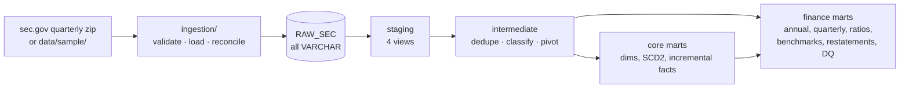

# SEC Financial Analytics — an analytics engineering layer on Snowflake

[](https://github.com/Karthik-Goud-Kasula/Analytics-Engineering-Layer-on-Snowflake/actions/workflows/ci.yml)


Turns the SEC's public **Financial Statement Data Sets** — every number from
every XBRL filing by US public companies — into a tested, documented star
schema on Snowflake: one row per company per year (and quarter) with income
statement, balance sheet and cash flow side by side, financial ratios, sector
benchmarks, restatement tracking and data-quality scores.

**Stack:** Python (ingestion) · Snowflake · dbt Core 1.12 · SQL · GitHub Actions ·
DuckDB (offline runs) · Apache Airflow 3 (reference DAG)

**At a glance**

| | |
|---|---|
| Pipeline | SEC zip → validated, transactional load → raw → staging → intermediate → marts |
| Models | 22 dbt models (4 staging views, 7 intermediate, 11 marts incl. one incremental fact table and an SCD2 dimension) |
| Tests | 132 dbt data tests, 4 dbt unit tests, 50 Python tests, an end-to-end oracle test, an incremental-vs-full-refresh reconciliation |
| Runs without credentials | `make ci` runs everything on DuckDB with a synthetic sample in about 3 minutes |
| On Snowflake | least-privilege roles, key-pair auth, one-statement setup script, an opt-in integration workflow |

> **Verification status:** end-to-end tested against a live Snowflake account
> (2026-10-15, dbt Core 1.12.6, dbt-snowflake 1.12.3): sample data loaded through
> the transactional loader; `dbt build` passed **twice** (`PASS=158 WARN=2 ERROR=0`,
> the second run exercising the incremental merge); all five
> [verification queries](snowflake/queries/verify_outputs.sql) returned the
> expected results when run as the read-only `SEC_ANALYST` role. Not yet run on
> real SEC data, and the Snowflake GitHub Actions workflow has not been run
> (see [Known limitations](#known-limitations)).

## Contents

- [The dataset, and why it's harder than it looks](#the-dataset-and-why-its-harder-than-it-looks)
- [Architecture](#architecture)
- [Models](#models)
- [Quick start (local, no credentials)](#quick-start-local-no-credentials)
- [Running on Snowflake](#running-on-snowflake)
- [Data quality and testing](#data-quality-and-testing)
- [Example queries](#example-queries)
- [Performance and cost](#performance-and-cost)
- [CI/CD](#cicd)
- [Repository layout](#repository-layout)
- [Known limitations](#known-limitations)
- [What I'd add next](#what-id-add-next)

Deeper documentation: [Architecture](docs/ARCHITECTURE.md) ·
[Modeling guide](docs/MODELING.md) · [Design decisions](docs/DECISIONS.md) ·
[Data dictionary](docs/DATA_DICTIONARY.md) · [Expected outputs](docs/EXPECTED_OUTPUTS.md) ·
[Troubleshooting](docs/TROUBLESHOOTING.md) · [Audit report](docs/REPOSITORY_AUDIT.md)

---

## The dataset, and why it's harder than it looks

The [SEC Financial Statement Data Sets](https://www.sec.gov/data-research/sec-markets-data/financial-statement-data-sets)
contain the numeric facts from the financial statements of every XBRL filing since
2009, published quarterly as four tab-delimited files. Millions of rows per quarter,
free, real, and messy in ways that make it a genuine modeling exercise rather than
a `SELECT *` demo.

Five problems have to be solved before a single number is trustworthy:

**1. The fact grain is eight columns wide.** A (filing, tag) pair legitimately appears
many times — per period end date, duration, unit, segment and co-registrant.
Grouping on (filing, tag) alone looks correct and silently over-counts. The surrogate
key in `stg_sec__numeric_facts` encodes the true grain so it is *tested*, not assumed.

**2. Annual, quarterly and year-to-date figures live in the same column.** `qtrs = 0`
is a balance, `1` a quarter, `4` a year, `2`–`3` year-to-date. Summing across them
inflates revenue roughly fivefold. Every model carries duration in its grain.

**3. There is no single revenue tag.** Depending on filer and taxonomy year, revenue is
`RevenueFromContractWithCustomerExcludingAssessedTax`, `Revenues`, `SalesRevenueNet`
or others. A seed maps 62 tags to 33 concepts with a priority, so the most specific
tag wins — and records which tag won, so every figure is traceable.

**4. Filings get amended — sometimes without any numbers.** A 10-K followed by a 10-K/A
is two filings for one year. `int_filings__deduplicated` picks one authoritative filing,
but only among filings that *contain financial statements*: a "Part III" amendment
(executive compensation only) is newer and would otherwise erase the year. The
superseded filings are kept, because `mart_restatements` compares them.

**5. A filing reports more than its own period.** A 10-K also contains last year's
figures (often recast), a subsidiary's figures, and segment breakdowns. The
classification layer keeps only the consolidated, current-period line items that
the filer actually presented on a statement.

---

## Architecture



* **Snowflake** is the target warehouse. **DuckDB** runs the identical dbt project
  from a local file, so development and CI need no credentials; three expressions
  are dispatched per warehouse and everything else is portable SQL.
* The loader validates each file's header and field counts, then loads a quarter
  in **one transaction** (delete, load, reconcile row counts) — re-running a quarter
  replaces it and a failure leaves the previous load intact.

Full lineage, layer contracts and the security model: [docs/ARCHITECTURE.md](docs/ARCHITECTURE.md).

---

## Models

| Layer | Model | Grain / purpose |
|---|---|---|
| staging | `stg_sec__submissions` | One row per filing, typed |
| staging | `stg_sec__numeric_facts` | One row per fact at the 8-column grain |
| staging | `stg_sec__tags` | One row per tag and taxonomy version |
| staging | `stg_sec__presentation` | One row per rendered statement line |
| intermediate | `int_filings__deduplicated` | One authoritative filing per company-period |
| intermediate | `int_facts__classified` | Consolidated current-period facts, one statement each |
| intermediate | `int_facts__income_statement` | Income statement pivoted, per filing and duration |
| intermediate | `int_facts__balance_sheet` | Balance sheet pivoted, per filing |
| intermediate | `int_facts__cash_flow` | Cash flow pivoted, per filing and duration |
| intermediate | `int_financials__annual` | Three statements joined, per company-year |
| intermediate | `int_financials__quarterly` | Q1–Q3 reported, Q4 derived |
| core | `dim_company` | Company, current attributes |
| core | `dim_company_history` | Company attributes over time (SCD Type 2) |
| core | `dim_filing` | Every filing, with authoritative flag and days-to-file |
| core | `fct_financial_facts` | Every fact, **incremental** on load time |
| finance | `fct_company_financials_annual` | **Primary analytical table**: one row per company-year |
| finance | `fct_company_financials_quarterly` | Quarterly with derived Q4 and YoY |
| finance | `fct_financial_ratios` | Profitability, returns, liquidity, leverage, efficiency |
| finance | `fct_yoy_growth` | Year-over-year growth against exactly the prior year |
| finance | `mart_sector_benchmarks` | Sector medians and quartiles (≥ 5 companies) |
| finance | `mart_restatements` | Amendments vs originals, materiality flag |
| finance | `mart_data_quality_summary` | Coverage by fiscal year, analysis-ready flag |

Every column is documented with a type in the [data dictionary](docs/DATA_DICTIONARY.md),
which is generated from the model YAML so it can't drift.

---

## Quick start (local, no credentials)

**Prerequisites:** Git, Python 3.10+ (tested on 3.12 and 3.14), `make`. No database server:
DuckDB is a Python package.

```bash
git clone https://github.com/Karthik-Goud-Kasula/Analytics-Engineering-Layer-on-Snowflake.git
cd Analytics-Engineering-Layer-on-Snowflake

python3 -m venv .venv && source .venv/bin/activate
make install          # pinned dbt-core, adapters, sqlfluff, pytest, ruff
make deps             # dbt_utils

make load-sample      # synthetic SEC-format sample -> data/warehouse/sec_analytics.duckdb
make build            # seeds, 22 models, 132 data tests, 4 unit tests
make test-e2e         # compare the marts with the expected results
```

`make build` ends with `PASS=158 WARN=2 ERROR=0`. The two warnings are deliberate —
see [Expected outputs](docs/EXPECTED_OUTPUTS.md). Then explore:

```bash
make docs-serve       # dbt docs with the lineage graph, http://localhost:8080
python -c "import duckdb; print(duckdb.connect('data/warehouse/sec_analytics.duckdb', read_only=True).sql('select company_name, fiscal_year, revenue, net_income from analytics_marts.fct_company_financials_annual order by 1, 2'))"
make ci               # everything CI runs, including the incremental reconciliation
```

`make help` lists every command. The sample is **synthetic**: ten fictional companies,
each built to exercise one edge case — see [data/sample/README.md](data/sample/README.md).

---

## Running on Snowflake

This is the path that was used to verify the project on a Snowflake trial account.
Allow about 30 minutes. Snowsight is Snowflake's web UI; everything else runs in a
terminal at the repository root with the virtual environment active.

### 1. Snowflake objects (one time, in Snowsight)

As `ACCOUNTADMIN` (a trial account's admin user), open a worksheet and run
[`snowflake/setup/00_setup_all_in_one.sql`](snowflake/setup/00_setup_all_in_one.sql):
statements A and B, then click inside block C and press **Run** once. It creates,
all prefixed `SEC_`:
- roles `SEC_LOADER`, `SEC_TRANSFORMER` and `SEC_ANALYST`, granted to you;
- an X-Small warehouse that suspends after 60 s;
- database `SEC_ANALYTICS_DEV` with the raw schema, file format, stage and tables;
- future grants;
- a key-pair-only service user for CI.

It is safe to re-run.

> Block C is deliberately **one statement**. Some Snowsight editors run only the
> statement under the cursor, which silently half-runs a multi-statement script.
> The equivalent multi-statement scripts, [`01_account_setup.sql`](snowflake/setup/01_account_setup.sql)
> and [`02_raw_tables.sql`](snowflake/setup/02_raw_tables.sql), use the textbook
> USERADMIN/SYSADMIN ownership. Run each with **Run All** (Ctrl/Cmd+Shift+Enter),
> never a plain Run.

### 2. Key pair

```bash
mkdir -p ~/.snowflake && chmod 700 ~/.snowflake
openssl genrsa 2048 | openssl pkcs8 -topk8 -inform PEM -out ~/.snowflake/snowflake_rsa_key.p8 -nocrypt
chmod 600 ~/.snowflake/snowflake_rsa_key.p8
openssl rsa -in ~/.snowflake/snowflake_rsa_key.p8 -pubout 2>/dev/null | grep -v "PUBLIC KEY" | tr -d '\n'; echo
```

In Snowsight, attach the printed line to your own user. No user name is needed:
```sql
alter user set rsa_public_key = 'MIIBIjANBgkq...';
```

### 3. Configure

```bash
cp .env.example .env      # git-ignored; read automatically by dbt and the loader
```

Set four values:

| Variable | Value |
|---|---|
| `SNOWFLAKE_ACCOUNT` | `orgname-accountname`, from `select current_organization_name() \|\| '-' \|\| current_account_name();` |
| `SNOWFLAKE_USER` | Your **login name**, which is often your sign-up email rather than your user name (the query is in `.env.example`) |
| `SNOWFLAKE_PRIVATE_KEY_PATH` | The **absolute** path printed by `echo "$HOME/.snowflake/snowflake_rsa_key.p8"` |
| `DBT_SNOWFLAKE_SCHEMA` | e.g. `dbt_karthik` |

Password authentication is deliberately not supported: Snowflake is blocking
password-only sign-in for programmatic users.

### 4. Connect, load, build, verify

```bash
make deps
make debug TARGET=dev                  # must end with "All checks passed!"
make load-sample TARGET=dev            # sample data -> RAW_SEC (one transaction per quarter)
make build TARGET=dev                  # Done. PASS=158 WARN=2 ERROR=0
make build TARGET=dev                  # again: exercises the incremental merge
```

Then run [`snowflake/queries/verify_outputs.sql`](snowflake/queries/verify_outputs.sql)
in Snowsight. Each query states its expected result. Connection errors (`JWT token is
invalid`, `No active warehouse`, ...) are covered in [Troubleshooting](docs/TROUBLESHOOTING.md).

### 5. Real SEC data

Clear the synthetic sample first, so fictional companies don't mix with real ones.
Run as `SEC_LOADER`: `truncate table` on `sub`, `num`, `tag` and `pre` in
`sec_analytics_dev.raw_sec`. Then:

```bash
# .env: SEC_USER_AGENT="Your Name you@example.com"  (required by the SEC)
make load-sec TARGET=dev QUARTERS=2024q1:2024q4     # ~60-120 MB per quarter
make fresh TARGET=dev                               # full refresh: the fact table still holds sample facts
```

Load only the quarters you need: they set the size of every dev build. `QUARTERS=latest`
loads the newest completed quarter (exits with code 99, "nothing to do", if it isn't
published yet).

---

## Data quality and testing

| Layer | What is checked |
|---|---|
| Ingestion | Header matches the SEC layout (by name; unknown columns rejected); every row has the right field count; loaded rows = file rows, else rollback |
| Staging | Grain uniqueness (the 8-column `fact_key`), not-null keys, relationships, accepted values, filed date not before period end, unparseable values reported (warn) |
| Intermediate | One authoritative filing per period; one row per filing/duration per pivot; one row per company-year and company-quarter; coverage regressions (`not_null_proportion`, a custom generic test) |
| Marts | Surrogate key uniqueness, relationships to every dimension, SCD2 windows without gaps or overlaps, no fan-out (`equal_rowcount`), ratio plausibility (warn), balance sheet identity (warn → error past 2,000) |
| Reconciliation | Incremental facts = staged facts; annual figures = the atomic facts they came from; Q1+Q2+Q3+Q4 = annual |
| Unit tests (dbt) | Dedup ignores Part III amendments; tag priority and EPS unit; Q4 only from complete quarters; SCD2 A→B→A = 3 versions |
| End to end | Every mart compared with an independent Python oracle built from the sample spec |
| Incremental | Load in batches (incl. an out-of-order backfill and a duplicate re-delivery) ≡ full refresh, table by table |

**When a test fails:** `dbt build` skips everything downstream of a failing
`error` test, so nothing is built on bad data; `warn` tests report and continue.
Failing rows of the warn-level domain tests are stored in `<schema>_dbt_test__audit`.
Fix the cause and `dbt retry`. Details: [Troubleshooting](docs/TROUBLESHOOTING.md).

---

## Example queries

Compiled examples live in [`analyses/`](analyses/) (`dbt compile`, then
`target/compiled/sec_analytics/analyses/`): sector peer comparison, material
restatements, growth leaders. Two more:

```sql
-- Which companies beat their sector's median operating margin last year?
select r.company_name, r.sector, r.operating_margin, b.median_operating_margin
from marts.fct_financial_ratios as r
join marts.mart_sector_benchmarks as b using (sector, fiscal_year)
where r.fiscal_year = 2023 and r.operating_margin > b.median_operating_margin
order by r.operating_margin - b.median_operating_margin desc;

-- Quarterly revenue trend, flagging derived Q4s
select fiscal_year, fiscal_quarter, revenue, is_derived_q4, revenue_yoy_growth_rate
from marts.fct_company_financials_quarterly
where company_name = 'ALDER SOFTWARE INC'
order by fiscal_year, fiscal_quarter;
```

(`marts` = your marts schema: `analytics_marts` locally, `dbt_<you>_marts` on Snowflake.)
Expected results for the sample data: [docs/EXPECTED_OUTPUTS.md](docs/EXPECTED_OUTPUTS.md).

---

## Performance and cost

* **Compute:** one X-Small warehouse, auto-suspend after 60 s, 15-minute statement
  timeout, optional monthly resource monitor. Query tags (`sec_analytics_dev`,
  `sec_analytics_ci`, `sec_analytics_loader`) attribute spend.
* **Materializations:** staging views (no storage); intermediate tables, because
  each feeds several models; one incremental model, where a full rebuild is
  actually expensive. dbt-snowflake creates tables as *transient* by default, so
  rebuildable tables pay no Fail-safe storage.
* **Incremental:** `merge` on `fact_key`, filtered on load time with a 24-hour
  lookback — processes only newly loaded quarters.
* **No clustering keys:** the original clustered a ratios table of a few thousand
  rows per year; automatic clustering costs credits and pays off on very large
  tables. The fact table's natural load order (one quarter at a time) already
  suits its load-time filter.
* **Loading:** files are compressed on `PUT`, loaded with one `COPY` each, and
  removed from the stage afterwards. Dev volume is controlled by which quarters
  you load.

---

## CI/CD

* [`ci.yml`](.github/workflows/ci.yml) — on every pull request and push to `main`,
  **no secrets needed**: ruff, Python tests, sample-data reproducibility, dbt build
  with all tests on DuckDB, end-to-end expected results, docs/data-dictionary
  freshness, sqlfluff (Snowflake dialect), an offline compile-and-parse of every
  model as Snowflake SQL, and the incremental reconciliation. A second job
  import-tests the Airflow DAG against Airflow 3.3.
* [`snowflake-integration.yml`](.github/workflows/snowflake-integration.yml) —
  manual. Builds and tests on a real Snowflake account in a per-run schema
  (`ci_<run id>_*`) that is always dropped afterwards. Needs repository secrets
  `SNOWFLAKE_ACCOUNT`, `SNOWFLAKE_USER`, `SNOWFLAKE_PRIVATE_KEY`.

Nothing deploys automatically. [`orchestration/airflow/dags/`](orchestration/airflow/dags/sec_financials_pipeline.py)
holds a reference Airflow 3 DAG (weekly load-then-build); it is import-tested,
not deployed.

---

## Repository layout

```
├── ingestion/               Loader (validate, load, reconcile), SEC download, sample generator
├── data/sample/             Synthetic SEC-format sample (6 quarters, 10 fictional companies)
├── snowflake/setup/         Roles, warehouse, database, grants, raw tables, teardown
├── snowflake/queries/       Output verification queries for Snowflake
├── models/
│   ├── staging/sec/         4 views + source and model YAML
│   ├── intermediate/        7 models + YAML (incl. dbt unit tests)
│   └── marts/{core,finance} 11 models + YAML
├── macros/                  safe_divide, date parsing (dispatched), pivot helpers, CI cleanup
├── seeds/                   Tag → concept mapping; SIC major groups → sectors
├── tests/                   7 singular tests + 1 custom generic test
├── analyses/                Example analytical queries (compiled, never materialized)
├── python_tests/            pytest: loader, layouts, Snowflake loader logic, e2e oracle, DAG
├── scripts/                 Project checks, data dictionary, incremental + Snowflake SQL checks
├── orchestration/airflow/   Reference Airflow 3 DAG
├── profiles/profiles.yml    dbt targets (local DuckDB, Snowflake dev/ci) — env vars only
├── .github/workflows/       Offline CI; manual Snowflake integration
└── docs/                    Architecture, modeling, decisions, dictionary, outputs, audit
```

---

## Known limitations

* **Verified on Snowflake with the synthetic sample only.** Real SEC data has not
  been loaded yet (the development environment could not reach sec.gov); the
  download path is unit-tested with simulated responses. Expect to extend the tag
  mapping when real filers use tags it doesn't cover.
* **The Snowflake GitHub Actions workflow has not been run.** It needs the
  repository secrets described in [CI/CD](#cicd). Pull-request CI runs offline on
  DuckDB.
* **Scope:** US-GAAP 10-K/10-Q filers. 20-F/40-F (often IFRS) filers appear in the
  dimensions but not the financial marts. Banks and insurers fit the model loosely
  (no gross profit, unclassified balance sheets). Lease liabilities aren't in debt.
* **As-reported figures:** each year comes from its own 10-K (or amendment); recasts
  inside later filings' comparatives aren't modelled. A derived Q4 absorbs any
  restatement between the 10-Qs and the 10-K. No quarterly cash flow (10-Qs report
  it year-to-date).
* Ratios use year-end, not average, balances. Sector is the SIC division (coarse).
* Facts deleted from a re-published quarter stay in the incremental table until a
  full refresh (a reconciliation test detects it).

## What I'd add next

* Load a year of real SEC filings and tune the tag mapping against
  `mart_data_quality_summary`.
* Run the Snowflake integration workflow on a schedule, and add Slim CI
  (`state:modified+`) once a production environment provides a baseline manifest.
* Test-result history and anomaly detection (e.g. dbt-elementary), so a slowly
  degrading coverage metric is visible before it fails a threshold.
* Average-balance ratios and quarterly cash flow (differencing year-to-date values).
* Model contracts on the finance marts, and dbt exposures for the dashboards that
  consume them.
* Validate a sample of computed figures against the SEC's XBRL company-facts API.
* Build and test on dbt v2 (the project already passes the v2 parser check).

---

## Author

**Karthik Goud Kasula** — Data Engineer · [GitHub](https://github.com/Karthik-Goud-Kasula)

Built as a portfolio project. It is not deployed at, or derived from, any employer.

## License and data

Code: [MIT](LICENSE). The SEC Financial Statement Data Sets are published by the
U.S. Securities and Exchange Commission and, as a U.S. government work, are in the
public domain; use of sec.gov is subject to the SEC's
[fair-access policy](https://www.sec.gov/os/accessing-edgar-data). The sample data in
`data/sample/` is synthetic and fictional. [dbt_utils](https://github.com/dbt-labs/dbt-utils)
is a dependency under the Apache 2.0 license.
