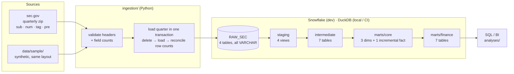
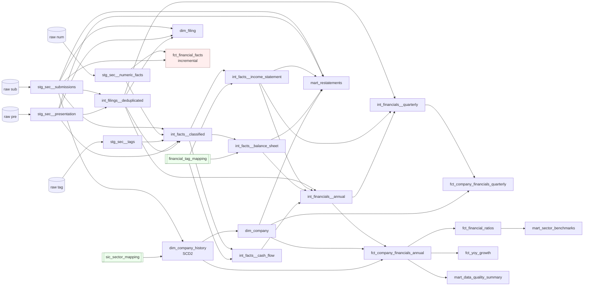

# Architecture

What runs, where, and in what order. Every component in these diagrams exists
in this repository; the lineage below was read from dbt's `manifest.json`.

## End-to-end flow

* **Snowflake** is the target warehouse (`dev` target, and the `ci` target used
  by the manual integration workflow).
* **DuckDB** is a local, file-based stand-in (`local` target) so the same models
  and tests run with no account and no credentials: for development, and on
  every pull request. Three macros are dispatched per warehouse
  (`parse_yyyymmdd`, and dbt's own `datediff`/`dateadd`); everything else is
  portable SQL. `scripts/check_snowflake_sql.py` compiles every model for
  Snowflake and parses it, so Snowflake-only syntax errors are caught offline.

## dbt lineage

`mart_restatements` deliberately reads all filings from staging, bypassing
`int_filings__deduplicated`: its job is to compare the filings that model hides.

`fct_financial_facts` is the only incremental model. Its reconciliation tests
compare it with staging (row count) and with the pivot path (revenue and net
income per filing), so the two independent routes through the project check
each other.

## Layers

| Layer | Materialization | Schema (dev) | Contract |
|---|---|---|---|
| Raw | tables (loader) | `RAW_SEC` | Exactly what the SEC published, all `VARCHAR`, plus `_source_quarter`, `_source_file`, `_loaded_at`. |
| Staging | view | `<schema>_staging` | One row per source row, renamed and typed with `try_` casts. Only exception: tags are deduplicated across quarterly files. |
| Intermediate | table | `<schema>_intermediate` | Deduplicated, classified, pivoted; one declared and tested grain per model. |
| Marts | table (+1 incremental) | `<schema>_marts` | Documented grain, surrogate keys, descriptors joined in, safe for BI. |
| Seeds | table | `<schema>_seeds` | Tag → concept mapping; SIC → sector ranges. |

dbt's default schema naming (`<target schema>_<custom schema>`) keeps every
developer (`dbt_jane_marts`) and every CI run (`ci_123456_marts`) isolated
without any macro override.

## Security model (Snowflake)

| Role | Can | Cannot |
|---|---|---|
| `SEC_LOADER` | Own `RAW_SEC`; PUT/COPY raw files | Read or write dbt schemas |
| `SEC_TRANSFORMER` | Read `RAW_SEC`; create and own dbt schemas | Modify raw data |
| `SEC_ANALYST` | Read every schema dbt creates (future grants) | Read raw data |

Authentication is key-pair only (Snowflake is blocking password-only sign-in for
service users). `profiles/profiles.yml` reads every credential from environment
variables, and `scripts/check_project.py` fails CI if a literal credential ever
appears in it.

## Orchestration

`orchestration/airflow/dags/sec_financials_pipeline.py` is a **reference DAG**
for Apache Airflow 3: weekly, load the latest quarter (skipped when nothing is
new), then `dbt build` layer by layer, docs, and a freshness check. It is
import-tested against Airflow 3.3 in CI. It is not deployed anywhere as part of
this project; the project runs end to end with `make` alone.

## Testing pyramid

| Level | What | Where |
|---|---|---|
| Python unit | quarter math, layout validation, loader transactions (DuckDB real, Snowflake faked), SEC download errors | `python_tests/` |
| dbt unit tests | dedup rules, tag priority + EPS unit, Q4 derivation, SCD2 gaps-and-islands | `_int__models.yml`, `_core__models.yml` |
| dbt data tests | keys, grains, relationships, accepted values, domain rules, reconciliations | model YAML, `tests/` |
| End to end | every mart vs. an independent Python oracle built from the sample spec | `python_tests/test_expected_outputs.py` |
| Incremental | incremental load sequence ≡ full refresh, table by table | `scripts/reconcile_incremental.py` |
| Snowflake syntax | every compiled statement parsed with two Snowflake grammars | `scripts/check_snowflake_sql.py` |
